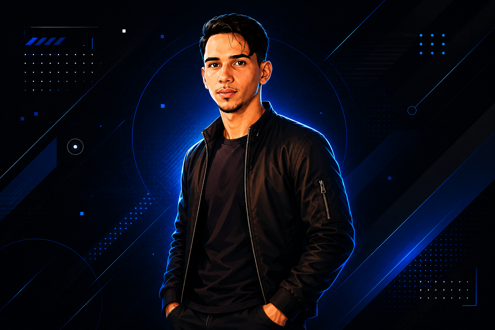

# 💼 Portfólio Ultra-Interativo | Lucas Emídio

<p align="center">
  
</p>

<p align="center">
  <b>Portfólio de alta fidelidade visual, com física 3D, partículas dinâmicas e design editorial não genérico para impressionar recrutadores.</b>
</p>

<p align="center">
  
  
  
  
  
</p>

---

## ⚡ Destaques & Interatividades Exclusivas

- **Imagem 3D Guiada pelo Mouse:** A ilustração no Hero responde ao movimento do cursor com rotação em perspectiva 3D (`rotateX`, `rotateY`), parallax em camadas e glow reativo.
- **Efeito de Espelhamento (Floor Reflection):** Reflexo holográfico suave no chão abaixo da imagem com desvanecimento por máscara de gradiente.
- **Animações de Fundo Vivas:**
  - **Canvas de Partículas:** Malha de constelação animada que conecta e reage à passagem do mouse.
  - **Orbes Aurora & Neon Mesh:** Esferas de luz com blur profundo flutuando organicamente.
  - **Cursor Spotlight:** Feixe de luz radial suave que acompanha o ponteiro pelo site.
- **Design Editorial (Adeus cards genéricos):**
  - **Terminal IDE Interativo:** Área "Sobre Mim" em formato de terminal com abas clicáveis (`perfil.js`, `habilidades.json`, `mindset.ts`) e sintaxe colorida real.
  - **Vitrine Showcase com Filtros:** Projetos organizados com destaque visual expansivo e filtros interativos por categoria.
  - **Hub Tecnológico:** Barras de proficiência com iluminação neon temática.
- **Efeito Typewriter Dinâmico:** Digitação contínua em tempo real no cabeçalho de apresentação.
- **Botão Copiar E-mail:** Cópia com 1 clique diretamente para o clipboard com feedback imediato ("Copiado! ✓").
- **Dark/Light Mode & Menu Mobile:** Totalmente adaptado para todas as resoluções de tela.

---

## 📂 Arquitetura do Projeto

```bash
portifolio_1/
├── index.html        # Página principal (pronta para o GitHub Pages)
├── port.html         # Versão espelho
├── port.css          # Estilos avançados, 3D tilt, orbes e responsividade
├── port.js           # Lógica do Canvas, 3D mouse follow, terminal e filtros
├── imgs/             # Imagens e capturas dos projetos
└── README.md         # Documentação completa
```

---

## 📬 Contato

- **WhatsApp:** (88) 99868-0880
- **E-mail:** [lucasemidioyt@gmail.com](mailto:lucasemidioyt@gmail.com)
- **GitHub:** [@lucasemidioalves181](https://github.com/lucasemidioalves181)

---
Desenvolvido com 💜 e muita dedicação por [Lucas Emídio](https://github.com/lucasemidioalves181).
